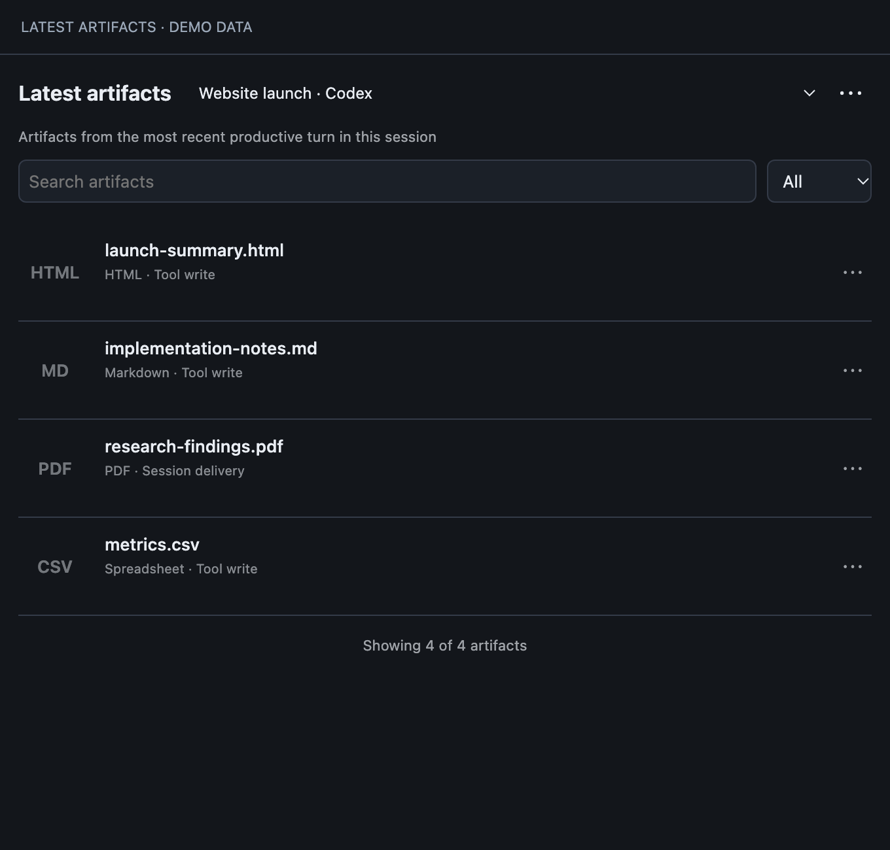
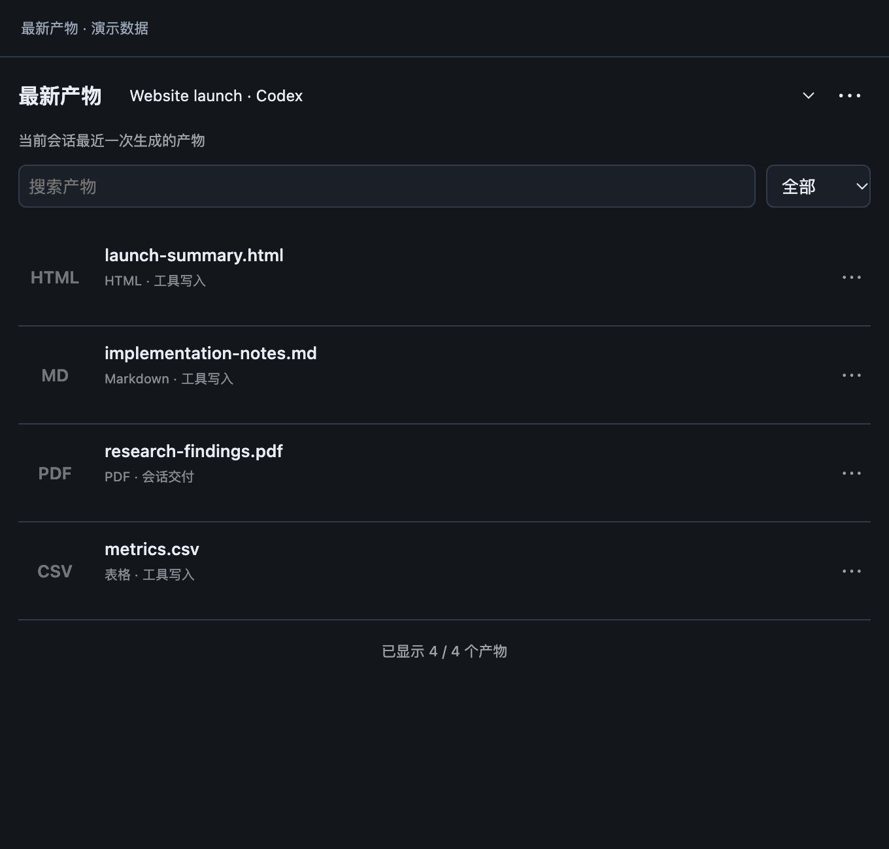

# Latest Artifacts for Orca

**Switch to an agent and see its latest deliverables—without digging through chat history or mixing in files from other sessions.**

[简体中文](README.zh-CN.md)

**Early release for macOS. Tested with Orca 1.4.257.** Windows, Linux and remote workspaces are not supported in this release.

## What it does

- Follows the focused native Codex/Claude chat or a verified local agent terminal.
- Shows the latest successful turn that actually produced files. A later answer with no files keeps the previous productive result.
- Lists HTML, Markdown, images, PDF, video and spreadsheets, with filenames first and optional thumbnails.
- Opens files inside Orca. Use Orca's built-in HTML Annotate and Markdown review notes for feedback.
- Supports Chinese and English based on Orca's UI language.
- Provides directory discovery as an explicit fallback when a session cannot be verified.

Terminal sessions without reliable turn identifiers are labelled **turn identity unavailable**. They show verified session artifacts, not a guessed latest turn. Session association uses successful tool-write evidence, explicit final-delivery paths or verified registrations; matching filenames and modification times alone are not enough.

The plugin does not send prompts, create agents or provide its own annotation overlay.

## Install

In Orca, open **Settings → Plugins → Install from GitHub** and use:

```text
xuan666-lab/orca-latest-artifacts
```

Or run:

```sh
orca plugin install xuan666-lab/orca-latest-artifacts --json
```

Orca will show the exact permissions and approval command. Review them before approving. The installed plugin key is `xuan666-lab.artifact-workbench`; the historical `artifact-workbench` id is retained for continuity. Open **Latest Artifacts / 最新产物** from the right sidebar.

## Requirements and optional previews

The file list works without the optional thumbnail tools. A missing renderer shows a file-type placeholder and a readable reason; it does not hide the file.

| Feature | Optional dependency |
| --- | --- |
| HTML and Markdown thumbnail | Google Chrome or Chromium |
| Image thumbnail | macOS `sips` |
| PDF thumbnail | `pdftoppm` from Poppler, plus `sips` |
| Video thumbnail | `ffmpeg` and `ffprobe`, plus `sips` |

Homebrew users can install PDF/video support with `brew install poppler ffmpeg`. Chrome is detected under `/Applications` and `~/Applications`; `ORCA_ARTIFACT_CHROME` can point to an absolute executable path if your Orca process is launched with that environment variable. No dependency is installed automatically.

## Compatibility and limitations

See [COMPATIBILITY.md](COMPATIBILITY.md). Automatic association reads Orca's local profile/session databases using **read-only** SQLite connections. Those schemas are internal, not a stable public API. Known schema versions are checked before use; a mismatch disables automatic association with an explanation. Directory discovery remains available. A newer Orca release is not automatically considered tested just because it meets the manifest's minimum version.

Large derived caches are compressed and split within Orca's storage limits. If the host's total cache quota is exhausted, regenerable indexes remain in memory and can be rebuilt from local history after a restart. The complete evidence index is not sent to the UI; artifact lists are paginated and searched on the worker.

## Privacy and access

This is a **trusted-worker** plugin, which runs local Node.js code with your user account's filesystem access. It reads local session records to identify artifact paths and may read Claude terminal transcripts when verifying an existing local session. It stores derived paths, file metadata, attribution evidence and thumbnails locally. It does not upload your files or transcripts, send analytics, or call an AI service. See [PRIVACY.md](PRIVACY.md).

Manifest capabilities: `storage:own`, `workspace:read`, `agent:read`, `terminal:read`. There is no `terminal:send` capability.

## Development

Node.js 24 or newer is required for the test runner and `node:sqlite`. No npm dependencies or build step are required.

```sh
npm test
orca plugin validate . --json
orca plugin check . --json
orca plugin dev load . --json
```

Media integration tests require the optional renderers above. CI runs on macOS and installs those tools. Tests use temporary synthetic databases and generated fixtures; they do not read your real conversations.

## Reporting problems

Open a GitHub issue with your Orca version, macOS version, whether the source is native chat or terminal, and the exact error message. Do not attach raw transcripts, profile databases, credentials, or private artifact screenshots.

MIT licensed. See [CHANGELOG.md](CHANGELOG.md).

## Optional explicit registration helpers

Advanced workflows can run `node register.mjs --path <file>` from the native Orca agent session that produced a file. For a new terminal session, `node terminal-track.mjs launch claude` (or `codex`) explicitly launches that CLI with temporary tracking hooks; `node terminal-track.mjs register --path <file>` registers a file from that tracked session. These are opt-in command-line helpers, not actions the sidebar runs automatically. They do not resume or replace an existing session.

## Preview

The screenshots below render the actual panel with synthetic example data, not private conversations.





For security, file actions are tied to the task and list revision that rendered their card. If you switch sessions before clicking an old card, the action is refused and you can retry from the refreshed list.
