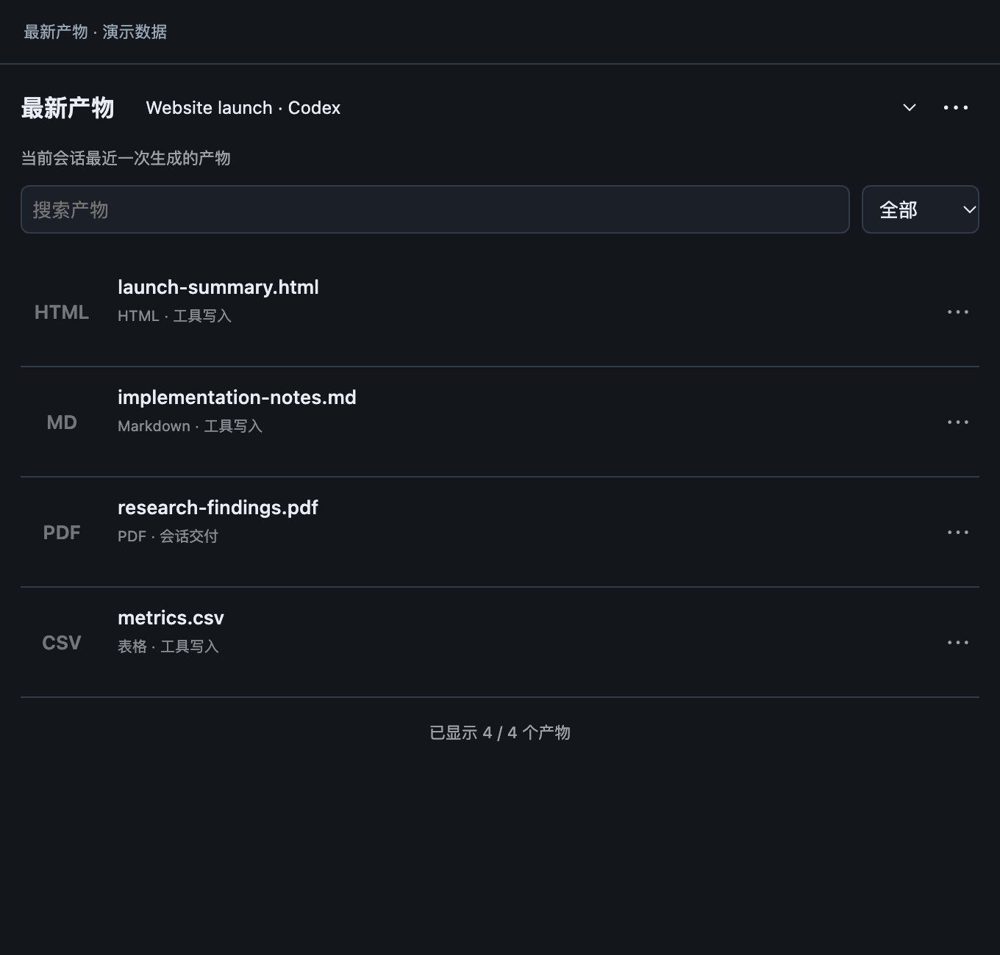

# 最新产物 · Orca 插件

查看当前 Agent 会话生成的文件，不必回翻聊天记录。

**首版仅支持 macOS，已测试 Orca 1.4.257。暂不支持 Windows、Linux 和远程工作区。**

## 功能

- 跟随当前原生 Codex／Claude 会话，或经过身份核验的本地 Agent 终端。
- 显示最近一个成功且产生文件的轮次；后续空问答不会清空这一批产物。
- 支持 HTML、Markdown、图片、PDF、视频和表格，文件名优先，可显示缩略图。
- 在 Orca 内打开文件，批注直接使用 Orca 自带的 HTML Annotate 和 Markdown 备注。
- 跟随 Orca 的中英文语言；支持分页和对完整产物列表进行搜索、筛选。
- 无法确认会话时，可手动切换「目录发现」。

终端没有可靠轮次标识时，界面明确显示「轮次不可确认」，只展示有证据的会话产物，不按修改时间猜测最新轮次。插件不发送提示词、不创建 Agent，也不注入圈选工具。

## 安装

在 Orca「设置 → 插件」中从 GitHub 安装 `xuan666-lab/orca-latest-artifacts`，或运行：

```sh
orca plugin install xuan666-lab/orca-latest-artifacts --json
```

检查 Orca 显示的权限后按提示批准。安装标识是 `xuan666-lab.artifact-workbench`，保留历史插件 ID；侧边栏名称为「最新产物」。

## 可选缩略图依赖

没有这些工具仍可查看、搜索和打开文件，只显示文件类型占位图。

| 缩略图 | 可选工具 |
| --- | --- |
| HTML／Markdown | Google Chrome 或 Chromium |
| 图片 | macOS 自带的 `sips` |
| PDF | Poppler 的 `pdftoppm` 和 `sips` |
| 视频 | `ffmpeg`、`ffprobe` 和 `sips` |

使用 Homebrew 时，可通过 `brew install poppler ffmpeg` 补齐 PDF／视频支持。插件不会自动安装软件。非标准 Chrome 安装位置可用 `ORCA_ARTIFACT_CHROME` 指定绝对可执行路径，需让 Orca 进程继承该环境变量。

## 数据与兼容性

插件在本机以只读方式核对 Orca 的内部数据库结构。这不是稳定公开 API；遇到不支持的版本会停止自动关联并说明原因，不会猜测或混入其他会话文件。详见 [兼容说明](COMPATIBILITY.md)。

大缓存会压缩并分块存储；总缓存配额不足时，可重建的索引保留在内存并显示提示。界面仅接收当前页，不传输完整证据索引。

插件运行在 trusted-worker 中，具有当前系统用户的文件访问权限。它会读取会话记录、核验产物路径，必要时读取原 Claude 终端会话记录。产物元信息和缩略图只保存在本机，不上传、不调用模型、不发送统计。详见 [隐私说明](PRIVACY.md)。

## 开发与反馈

使用 Node.js 24 或更新版本运行 `npm test`；无需安装 npm 依赖。测试使用临时合成数据库。真实缩略图测试需要上面的可选工具。

反馈请提供 Orca／macOS 版本、会话类型和错误文字，不要上传原始会话、数据库、密钥或内部文档截图。

## 可选登记脚本

高级流程可在产出文件的原生 Orca Agent 会话中运行 `node register.mjs --path <文件>` 进行明确登记。`node terminal-track.mjs launch claude`（或 `codex`）是用户主动启动新终端会话时使用的追踪包装器，不会由侧边栏自动调用，也不会替换已有会话。


